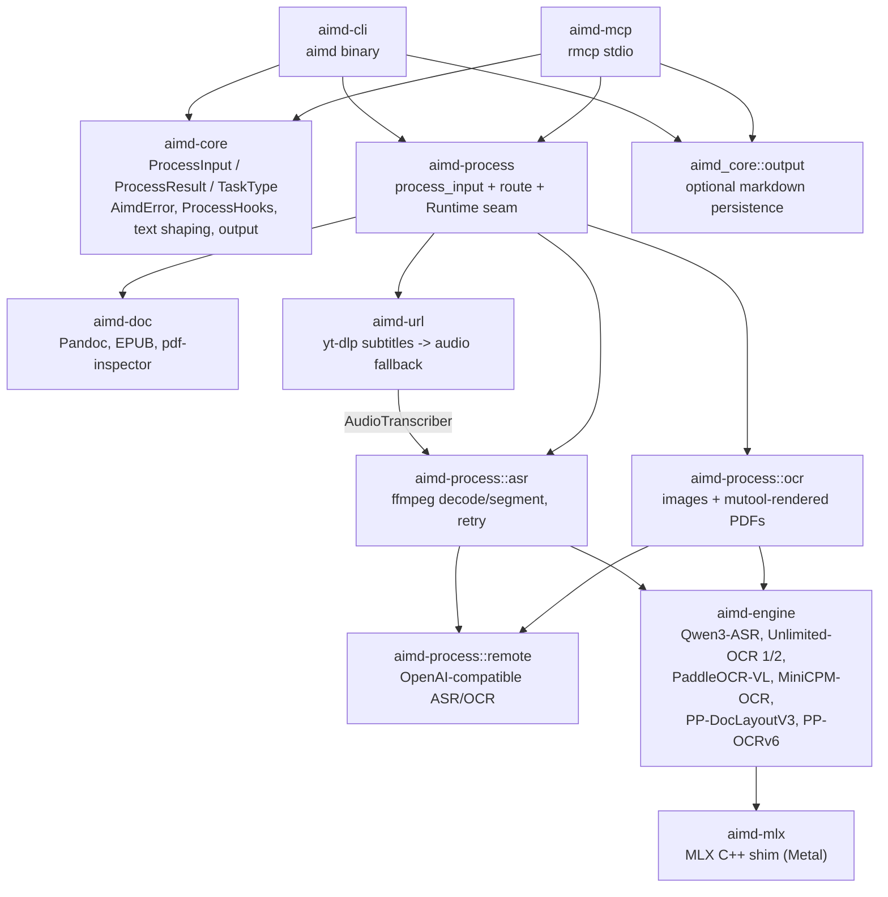

# PROJECT KNOWLEDGE BASE

**Generated:** 2026-10-26
**Version:** 1.3.1
**Branch:** main

## OVERVIEW

`aimd` is a native Rust context-preparation toolkit for LLM workflows. It turns URLs,
audio/video, and documents into Markdown plus a chunked text context. Local ASR
(Qwen3-ASR) and OCR (Unlimited-OCR, Unlimited-OCR-2, PaddleOCR-VL-1.6, MiniCPM-OCR 1.0 on
PP-DocLayoutV3 regions, PP-OCRv6) run on MLX through a C-ABI shim; there is no Python
runtime.

Interfaces (one binary each):

- **CLI**: `aimd` (`crates/aimd-cli`)
- **MCP server**: `aimd-mcp` (`crates/aimd-mcp`, rmcp stdio)

Distribution:

- **Homebrew**: `brew install shuuul/tap/aimd` (formula in `shuuul/homebrew-tap`).
  Bottles for macOS arm64. Linux (x86_64/aarch64, NVIDIA) builds from source against
  the tap's `mlx-cuda`, which repackages MLX's official `mlx-cuda-13` wheel; the NVIDIA
  driver, CUDA 13, cuDNN 9 and NCCL 2 come from the system. No Linux bottles: hosted
  runners have no NVIDIA driver to load `libmlx.so`.
- **Runtime deps** (formula `depends_on`): `mlx` (macOS) / `shuuul/tap/mlx-cuda`
  (Linux), `ffmpeg`, `mupdf` (`mutool`), `pandoc`, `yt-dlp`. Model weights download from Hugging Face on first use into the HF
  cache.
- **Version source**: `[workspace.package] version` in the root `Cargo.toml`.

## CRATE MAP

The Cargo workspace root is the repo root (`Cargo.toml`, `Cargo.lock`). `target*/` is
gitignored.

```text
crates/
├── aimd-weights/   # safetensors mmap; MLX affine 4/8-bit unpack (test-only bit-exact oracle); tests/golden/quant
├── aimd-mlx/       # C-ABI shim over MLX C++ (build.rs + shim/); device selection; needs brew mlx
├── aimd-engine/    # tokenizer, mel front-end, model graphs + generation (models/{qwen3_asr,qwen3_aligner,unlimited_ocr,paddleocr_vl,minicpm_ocr,pp_doclayout_v3,pp_ocrv6})
├── aimd-core/      # models, AimdError/ErrorKind, ProcessHooks, text shaping, precision, remote config,
│                   # extension tables, output persistence + shared help texts, logging; no heavy deps
├── aimd-doc/       # Pandoc conversion, EPUB (hand-written zip + OPF/spine), cleanup, pdf-inspector PDFs
├── aimd-url/       # yt-dlp metadata/subtitles/audio, cookies, metadata ASR context, dom_smoothie readable HTML
├── aimd-process/   # routing + orchestration: Runtime seam, local ASR/OCR, remote backends, model resolution, HF cache
├── aimd-cli/       # `aimd` binary: hand-written arg parser, output naming, .env loading
├── aimd-mcp/       # `aimd-mcp` binary: rmcp stdio server (healthz, process_input)
└── xtask/          # repo tooling (`cargo xtask check-specs`)
```

Dependency direction: `aimd-core` <- `aimd-doc`, `aimd-url` <- `aimd-process` (also
`aimd-engine`, `aimd-mlx`) <- `aimd-cli` / `aimd-mcp`. `aimd-doc` and
`aimd-url` depend only on `aimd-core`. The URL audio fallback reaches ASR through the
`aimd_url::AudioTranscriber` trait, which `aimd-process` implements
(`UrlAudioTranscriber`). This keeps the crate graph acyclic.

Other trees: `scripts/` holds the standalone PEP 723 reference exporters (used only to
regenerate goldens, not shipped). `docs/` holds architecture and performance
notes. `specs/` holds tracked execution specs.

## ARCHITECTURE DIAGRAM



## WHERE TO LOOK

| Task | Location | Notes |
|------|----------|-------|
| Input routing | `crates/aimd-process/src/route.rs` | `get_input_route` / `ensure_supported_input` map source kind + task into an `InputRoute`; `parse_task`. |
| Orchestration | `crates/aimd-process/src/lib.rs` | `process_input` / `process_input_with(request, hooks, &dyn Runtime)`; local-file dispatch, MarkItDown-style normalization, `TextContext` wrapping. |
| System seam | `crates/aimd-process/src/lib.rs`, `native.rs` | `Runtime` trait (env, `which`, subprocess, preflight, model loading, PDF probe); `NativeRuntime` is the real system. Tests override pieces. |
| PDF/OCR routing | `crates/aimd-process/src/native.rs` | pdf-inspector probe: scanned or `has_encoding_issues` PDFs route to OCR. |
| Model + precision resolution | `crates/aimd-process/src/models.rs` | Alias/precision to model keys; `ocr_family` decodes them for `NativeRuntime::load_ocr`; native gates; 8-bit fallback; ASR language codes. |
| Precision parsing | `crates/aimd-core/src/precision.rs` | Normalizes `4bit`/`6bit`/`8bit`/`bf16` and dash/space/case variants. |
| HF checkpoints | `crates/aimd-process/src/hf.rs` | Cache lookup (`HF_HUB_CACHE` > `HF_HOME/hub` > `~/.cache/huggingface/hub`), HTTPS snapshot download, `HF_TOKEN`, `HF_ENDPOINT`, `HF_HUB_OFFLINE`. |
| Local ASR | `crates/aimd-process/src/asr.rs`, `audio.rs` | ffmpeg decode to 16 kHz mono, >600 s segmenting, context, 4-bit -> 8-bit repetition retry. |
| Local OCR | `crates/aimd-process/src/ocr.rs` | Images and `mutool draw` PDF pages rendered in the background (`PdfRenderJob`); per-page progress and cancellation. |
| Remote backends | `crates/aimd-core/src/remote.rs`, `crates/aimd-process/src/remote.rs` | `AIMD_{ASR,OCR}_{BASE_URL,MODEL,API_KEY}`, `/v1` suffix; ureq + rustls. |
| Request/result models | `crates/aimd-core/src/model.rs` | `ProcessInput`, `ProcessResult`, `TextContext`, `TaskType`, `SourceKind`; serde names are the wire format. |
| Errors | `crates/aimd-core/src/error.rs` | `AimdError { kind, message }`, `ErrorKind` with a stable snake_case name. |
| Cancellation/progress | `crates/aimd-core/src/hooks.rs` | `ProcessHooks` (`is_cancelled`, `progress`, `check_cancelled`), `NoHooks`. |
| Text shaping | `crates/aimd-core/src/text.rs` | Title extraction and header/paragraph chunking (`MAX_CHUNK_SIZE`). |
| Source anchors | `crates/aimd-core/src/anchors.rs` | OCR `<!-- aimd:loc -->` comments, sentence split, unit-to-sentence timing, `[hh:mm:ss]` paragraphs, subtitle cues, SRT/VTT write/parse. |
| Output persistence + help texts | `crates/aimd-core/src/output.rs` | `persist_result_output_if_requested`; `OutputFormat`, `result_payload`/`payload_text` (MCP response, CLI `--format json`), `subtitle_text`; `MODEL_HELP_TEXT`, `PRECISION_HELP_TEXT`, `CONTEXT_HELP_TEXT`. |
| Extension tables | `crates/aimd-core/src/ext.rs` | Audio/video/image/OCR/asset extensions and the Pandoc reader map. |
| CLI | `crates/aimd-cli/src/args.rs`, `app.rs` | Hand-written parser over the frozen flag surface; output naming; `.env` loading. |
| MCP server | `crates/aimd-mcp/src/lib.rs` | Tool schemas, argument validation, `spawn_blocking` processing. |
| Document conversion | `crates/aimd-doc/src/` | `pandoc.rs`, `epub.rs` + `zip.rs` (hand-written), `clean.rs`, `pdf.rs` (pdf-inspector). |
| URL conversion | `crates/aimd-url/src/` | `ytdlp.rs`, `subtitles.rs`, `cookies.rs`, `metadata.rs` (`build_metadata_context`, 2000 chars), `audio.rs`, `readable.rs`. |
| Model graphs | `crates/aimd-engine/src/models/{qwen3_asr,qwen3_aligner,unlimited_ocr,paddleocr_vl,minicpm_ocr,pp_doclayout_v3,pp_ocrv6}/` | `unlimited_ocr` also holds v2 (`dash.rs`, `markdown2.rs`). MLX graphs, generation loops, n-gram guard, `test_support.rs` shared fixtures. PP-OCRv6 host ops (cv2-exact resize, contours, min-area rect, unclip, perspective crop, CTC) are hand-written in `pp_ocrv6/{image_ops,db,ctc}.rs`. |
| MLX shim | `crates/aimd-mlx/{build.rs,shim/,src/lib.rs}` | Links brew mlx (`MLX_PREFIX` override); `AIMD_MLX_DEVICE`. `src/dash.rs`: DASH router/prefill/decode ops. `gated_delta`/`gated_delta_gates`/`conv1d` (Qwen3.5 decoder), `src/grid_sample.rs` (deformable attention). |
| Golden corpus | `scripts/corpus/`, `scripts/{build_corpus,corpus_baseline,corpus_baseline_paddle}.py`, `crates/aimd-engine/examples/corpus_gate.rs` | Labeled ASR/OCR accuracy gate vs the mlx-audio / mlx-vlm / mlx4ocr reference; `--ocr-model` picks the OCR family. |
| Tracked specs | `specs/` | Lifecycle, numbering, and index in `specs/README.md`. |

## CONVENTIONS

- **Core is interface-independent**: `aimd-core`, `aimd-doc`, `aimd-url`, `aimd-process`,
  and `aimd-engine` never depend on `aimd-cli` or `aimd-mcp`. Interfaces build
  a `ProcessInput` and call `aimd_process::process_input`. Request/response shaping
  stays in the interface crate.
- **Route model**: classify inputs with `InputRoute { source_kind, task_type }`.
  `source_kind` is the supplied input kind, and `task_type` (`transcript`, `convert`,
  `ocr`) selects processing logic.
- **Runtime seam**: everything that touches the system (env, `PATH`, subprocesses, model
  loading, device preflight, PDF probing) goes through `aimd_process::Runtime`, so
  hermetic tests can substitute fakes. Interfaces receive an `Arc<dyn Runtime>` or a
  `Processor`.
- **Typed errors**: return `aimd_core::AimdError` with the right `ErrorKind`.
  Missing tools, models, or device (`pandoc`, `yt-dlp`, `ffmpeg`, `mutool`, MLX GPU) ->
  `BackendUnavailable`. Missing inputs -> `InputNotFound`. Unsupported inputs or options
  -> `UnsupportedInput`. Conversion failures -> `ProcessingFailed`. Cancellation ->
  `Cancelled`.
- **Cooperative cancellation**: thread `&dyn ProcessHooks` through core, doc, URL,
  ASR, and OCR. Call `check_cancelled` only at safe boundaries (between segments, pages,
  chapters), never inside uninterruptible model calls or subprocesses. Work that
  finishes during a late cancellation stays a completed artifact, never discarded.
- **Output ownership**: `output_file` belongs to the CLI/MCP, not to `ProcessInput`
  or `ProcessResult`. Persist through `aimd_core::output`. Asset conversions
  (`output_dir` set) ignore `output_file`. Persisted files are `markdown`
  byte-for-byte, never rebuilt from `chunk_list`.
- **Stable output contract**: `ProcessResult` keeps the lossless `markdown`, an optional
  `asset_base_uri` (directory URIs end in `/`), an optional `output_dir`, an optional
  `platform`, and optional `segments`, alongside
  `TextContext { title, chunk_list, split_header_level }`. Viewers consume `markdown`;
  context-window consumers use `chunk_list`.
- **Source anchors** (spec 005): `ProcessInput.anchors` (default `false`; CLI
  `--anchors`, MCP `anchors`; `--no-anchors` is still accepted as a no-op) adds OCR
  `<!-- aimd:loc page=P bbox=x0,y0,x1,y1 kind=K -->` comments (1-based page, bbox
  normalized 0..1, 3 decimals) and `[hh:mm:ss] ` transcript paragraphs to `markdown`.
  `ProcessInput::wants_positions()` (`anchors || include_segments`) gates forced
  alignment and `ProcessResult.segments`; CLI `--format json/srt/vtt` set
  `include_segments`. With both off the output must match the pre-anchor output byte
  for byte and skip forced alignment. Positions come through the
  `OcrModel::recognize_located` / `AsrModel::transcribe_aligned` seams (defaults: none);
  local ASR aligns 295 s segments (the aligner caps at 300 s; ffmpeg overshoots a 300 s
  cut by milliseconds) with Qwen3-ForcedAligner-0.6B-8bit, loaded lazily once per process.
  It covers zh, yue, en, de, es, fr, it, pt, ru and ko (not Japanese). Anything unaligned
  (remote ASR, unsupported language, failed alignment) spreads its sentences over the
  segment span instead of failing. JSON segment coordinates round to 3 decimals, times
  to ms. `include_segments` (MCP; CLI `--format json`)
  returns `segments` and enables the PaddleOCR-VL `Spotting:` pass. MCP response fields
  are additive (`segments` last).
- **Wire compatibility**: MCP JSON field names, error bodies, and tool
  schemas match the frozen Python contract. Change them only with an explicit decision.
- **Fail-fast preflight**: resolve the model and check the backend (MLX GPU device,
  required tools) before expensive work such as PDF rendering, downloads, or
  transcoding. Local inference on the MLX CPU device is `BackendUnavailable`.
- **URL cookie behavior**: keep automatic browser-cookie probing when no cookie option is
  supplied; it is intentional user convenience for restricted media. Explicit cookie
  options that yt-dlp rejects fail fast (`UnsupportedInput`). Subtitle and audio
  fallback failures must not be hidden behind metadata-only success results.
- **URL fallback ordering**: subtitles first (language preference order, then formats),
  then audio download + ASR. If both produce no text, the request is a processing
  failure. Stale-extractor yt-dlp stderr gets the `brew upgrade yt-dlp` hint.
- **Model naming**: user-facing aliases are kebab-case: `qwen3-asr-1.7b` (default),
  `qwen3-asr-0.6b`, `unlimited-ocr-2` (OCR default), `unlimited-ocr`, `paddleocr-vl`, `minicpm-ocr`, and `pp-ocrv6`. Legacy underscore aliases and explicit
  `mlx-community/*` ids remain compatibility inputs but must not be the canonical names in
  docs or help text. GLM-OCR and Transformers/`Qwen/*` ids are not supported and must
  not reappear in help text.
- **Precision separation**: model family/size goes through `model`; quantization goes
  through the separate `precision` option. The parser accepts `4bit`, `6bit`, `8bit`, and
  `bf16` (dash/space/case variants normalized in `aimd_core::precision`). The native
  engine runs Qwen3-ASR and Unlimited-OCR (1 and 2) at `4bit` (default), `6bit`, and `8bit`;
  `bf16` is rejected for them as `BackendUnavailable`. PaddleOCR-VL and MiniCPM-OCR default to
  dense bf16 and quantize at load; PP-OCRv6 ignores precision with one warning. A precision that conflicts
  with an explicit checkpoint id is an error.
- **Precision propagation**: `ProcessInput.precision` must be forwarded by CLI,
  MCP, URL audio fallback, local ASR, and OCR.
- **ASR context biasing**: `ProcessInput.context` (explicit text) and
  `ProcessInput.metadata_context` (default `true`) are forwarded by CLI
  (`--context`/`--no-context`) and MCP. `aimd-url` builds context from page
  metadata (title/author/description/tags/chapters, capped at 2000 chars) and merges it
  into the audio fallback. Qwen3-ASR consumes it as the system message. Never feed
  first-pass ASR output back as context.
- **4-bit retry**: a 4-bit Qwen3-ASR segment that trips the repetition-loop detector is
  retried once with the matching 8-bit checkpoint. Other precisions and remote ASR do not
  auto-switch.
- **Remote inference**: `AIMD_ASR_BASE_URL` / `AIMD_OCR_BASE_URL` (or the explicit
  CLI/MCP fields) opt into OpenAI-compatible HTTP backends and bypass local MLX
  preflight. Optional `AIMD_{ASR,OCR}_{MODEL,API_KEY}` have matching fields. Bare server
  URLs gain `/v1`. Explicit values override the environment. Remote precision is
  server-owned, so a local `precision` is ignored with one warning. Remote OCR picks
  the instruction from the served model name: `Unlimited-OCR-2*` gets
  `<PAGE><image>\nMulti page parsing.` and `render_unlimited_ocr2`; anything else
  gets v1's `<image>\ndocument parsing.`.
- **MLX only**: MLX is the only compute backend (Metal on macOS, the mlx CUDA backend on
  Linux). Do not add CPU compute paths or hand-written CUDA. The WS-08 custom Metal
  kernels are gated on `aimd_mlx::metal_kernels_available()`; other GPU backends use
  the stock mlx ops.
- **Fused elementwise ops**: shapeless compiled shim ops (`swiglu`, `gelu`,
  `gelu_tanh`, `rope_half_split`, `bias_act`) run on every backend and must match
  the unfused graph value for value (tested in `aimd-mlx/tests`). Do not
  compile whole models shape-keyed: every new page/clip shape would retrace
  (spec 006).
- **Host/GPU overlap** (spec 007): decode loops submit step k+1
  (`async_eval`) before reading token k back, like mlx-lm `generate_step`.
  On Apple the shim defaults `MLX_MAX_MB_PER_BUFFER` to 30 (a user value
  wins). Larger Metal command buffers keep the previous step's KV arrays
  alive, so `slice_update` copies the cache instead of donating it (MoE
  Unlimited-OCR lost 15%). Host-side image work threads through
  `aimd_engine::parallel` (`for_row_bands`, ordered `map`), computing each
  element exactly as one thread would. PDF OCR renders pages on a
  background thread (`PdfRenderJob`, PPM for local engines, PNG for remote)
  at most two pages ahead.
- **Linux build**: `aimd-mlx` links `libmlx.so` from `MLX_PREFIX` (brew `mlx-cuda`, or
  an unpacked `mlx-cuda-13` wheel for dev). Cargo applies the shim's rpath only to
  `aimd-mlx`'s own targets, so dev runs of dependents need
  `LD_LIBRARY_PATH=$MLX_PREFIX/lib` (brew's linker shim adds the rpath for installs).
  The shim points `CUDA_HOME` at `/opt/cuda` when unset and `/usr/local/cuda` is
  absent, because mlx's CUDA JIT needs the toolkit headers. It also caps mlx's memory
  limit at 90% of the VRAM free at device selection. mlx sizes that limit from total
  VRAM, so without the cap its buffer cache runs a shared GPU out of memory.
- **Document tools**: Pandoc (brew) reads every supported document format; `.txt`/`.md`
  pass through; legacy `.doc`/`.ppt`/`.xls` and MOBI/AZW3 are unsupported. Text-layer
  PDFs use the `pdf-inspector` crate; scanned pages render with `mutool draw`.
  Pandoc 3.12 rejects xlsx workbooks whose rels use absolute targets (openpyxl
  output); Excel-style relative targets convert.
- **Readable HTML**: `aimd_url::convert_readable_html` (dom_smoothie, with
  `AIMD_READABLE_BACKEND=defuddle` as an escape hatch) exists but is not routed from any
  interface. Do not advertise it until a `TaskType` routes to it.

## DEPENDENCY POLICY

Hand-write the simple parts; use third-party crates only for genuinely complex domains.

- **Hand-written**: CLI argument parsing, zip central-directory reading, OPF/spine
  walking, Netscape cookie parsing, UUIDs/timestamps, `.env` parsing,
  TTML/srv subtitle XML parsing.
- **Third-party (approved)**: `rmcp` (MCP),
  `serde`/`serde_json`, `pdf-inspector` (PDF text layer + OCR probe), `dom_smoothie`
  (readability), `regex`, `miniz_oxide` (deflate), `ureq` with `rustls` (remote backends,
  HF downloads), `image`, `tokenizers`, `safetensors`, `memmap2`, `half`, `thiserror`,
  `cc` (shim build).
- New crates need a stated reason that the domain is complex. Add shared versions under
  `[workspace.dependencies]` only with coordinator sign-off, because parallel builds
  share `Cargo.lock`.
- External tools come from Homebrew `depends_on`, never from a bundled downloader.

## TRACKED SPECS

Long-running, multi-workstream, or handoff-heavy work is tracked as execution
specs in `specs/` with a validated lifecycle. A spec records intent,
decisions, workstream progress, and acceptance evidence; it does not replace
durable docs, code, tests, or schemas. Stable behavior must still land in the
nearest `AGENTS.md`, docs, and code after closeout.

When a spec is required:

- Work spans multiple workstreams, agents, or explicit handoffs.
- Work needs coordinated decisions or acceptance evidence before parallel
  work starts.

How to write and close a spec:

1. Copy `specs/000-template.md` to `specs/NNN-kebab-case.md`. Reserve the
   next free ID by scanning both `specs/` and `specs/archive/`; never reuse,
   renumber, or delete an ID.
2. Fill the flat frontmatter (`id`, `title`, `status`, `created`, `updated`,
   `coordinator`) and every required section: `Context`, `Goal and success
   criteria`, `Scope and non-goals`, `Decisions`, `Workstreams`,
   `Verification`, `Documentation sync`, `Progress and handoff`, and
   `Completion summary`.
3. Add the index row to `specs/README.md` in ascending ID order and set
   `status: Active` once the contract is decision-complete. Reserve the ID
   and index the spec BEFORE parallel work starts.
4. Workers claim a workstream row (`WS-01`, ...) before editing and append
   entries under `Progress and handoff`; never rewrite another worker's
   history. Record blocking at the workstream level, not as a fourth status.
5. Close out by satisfying every success criterion (or recording the decision
   that removed one), syncing lasting knowledge into docs/`AGENTS.md`,
   completing the summary, setting `status: Completed`, and moving the file
   plus its index row to `specs/archive/` in the same change.
6. Run `cargo xtask check-specs` after any spec change and always before
   archiving.

Canonical lifecycle, numbering, coordination, and closeout rules live in
`specs/README.md`; the `xtask` validator enforces them structurally.

## MODEL AND PRECISION DESIGN

The user-facing model selection contract separates model family/size from
precision:

```bash
aimd audio.wav --model qwen3-asr-1.7b --precision 4bit
aimd audio.wav --model qwen3-asr-0.6b --precision 8bit
aimd scan.pdf --model unlimited-ocr --precision 8bit
```

Supported model families are intentionally narrow:

- **ASR**: `qwen3-asr-1.7b` (default) and `qwen3-asr-0.6b`. Omitted precision defaults
  to `4bit` and resolves to `mlx-community/Qwen3-ASR-{1.7B,0.6B}-{4bit,6bit,8bit}`.
  Omitted `language` means auto-detect (no forced language in the prompt) for local
  ASR, every segment, the 8-bit retry, and the URL audio fallback; URL metadata and
  title heuristics steer subtitle choice only. Explicit codes come from
  `aimd_engine::tokenizer::ASR_LANGUAGES` (30 languages).
- **Unlimited-OCR vision + R-SWA** (v1 and v2 share the towers): the numerical source of
  truth is Baidu's `deepencoder.py` / `modeling_deepseekv2.py`, not mlx-vlm. CLIP uses
  `quick_gelu` and LayerNorm eps 1e-5; crop pos embeds resample the CLIP grid spatially
  (bicubic antialias) and SAM rel pos with the half-pixel linear index. v1's ring cache
  keeps the whole prompt (`KvCache::retain_prompt`), then a 128-token decode ring.
- **OCR v1**: `unlimited-ocr`, resolving to `mlx-community/Unlimited-OCR-{4bit,6bit,8bit}`
  (default 4bit). OCR uses single-image gundam mode (`document parsing.`), the
  sliding-window no-repeat n-gram guard (35/128), and `max_tokens=8192` per page.
  PDFs go in 5-page `recognize_pages` windows (upstream `infer_multi`: one 1024 base
  view per page, `Multi page parsing.`, no `<PAGE>` in the prompt). v1 writes `<PAGE>`
  as 3 text tokens; the page-count guard matches that sequence and substitutes it for
  an EOS before the last page. A window of one page keeps the gundam request. v1
  matched page-by-page output through 6 pages; 7+ loop or repeat page 1 (spec 008).
- **Unlimited-OCR-2**: `unlimited-ocr-2`, resolving to
  `mlx-community/Unlimited-OCR-2-{4bit,6bit,8bit}` (default 4bit). The default OCR model (omitted `model`);
  a separate model from v1, which stays `unlimited-ocr`. The decoder uses DASH block-sparse
  attention (block 32, local window 128, top-k 12 routed blocks, entmax15 prior, page2d
  RoPE) through the `aimd_mlx::dash` shim ops: custom Metal kernels, the same block
  selection from mlx gathers elsewhere. Never fall back to dense attention; the dense
  `DashMode` is a test oracle only. Prompt: `[bos] + ([<PAGE>] + <image>*n)` per page +
  `Multi page parsing.`. Every page is gundam-tiled (max 16 crops), single images and
  multi-page requests alike (mlx-vlm's default; upstream `infer` uses base mode for
  several pages, which misreads small text and loops on long documents). PDFs go through `OcrModel::recognize_pages` in 10-page windows
  (`pages_per_request`), with progress and cancellation between windows. Generation
  carries the upstream page-count guard (EOS banned until every `<PAGE>`, forced past
  it, 20000 tokens per page) and widens the n-gram window to 1024 for multi-page
  requests. `markdown2::render_unlimited_ocr2` turns the 0..999 page-relative boxes
  into per-page located items.
- **PaddleOCR-VL**: `paddleocr-vl` (`paddleocr-vl-1.6`) always loads the official
  `PaddlePaddle/PaddleOCR-VL-1.6` bf16 checkpoint. Omitted precision = dense bf16;
  `4bit`/`6bit`/`8bit` quantize at load (affine, group 64, mlx-vlm convert rule: every
  module with `in_dim % 64 == 0`; vision `fc2` stays dense), bit-exact with
  `mlx-community/PaddleOCR-VL-1.6-4bit`. Model key: the repo id, plus `:<precision>`
  when quantized. Full-page `OCR:` prompt, image pixels 112896..1003520, 4096 tokens.
- **MiniCPM-OCR**: `minicpm-ocr` (`minicpm-ocr-1.0`) always loads the official
  `openbmb/MiniCPM-OCR-1.0` bf16 checkpoint plus `PaddlePaddle/PP-DocLayoutV3_safetensors`
  (f32, never quantized). Model key: the repo id, plus `:<precision>` when quantized;
  `4bit`/`6bit`/`8bit` quantize only the full-attention q/k/v/o and the MLPs (mlx-vlm's
  convert set). The model recognises regions, not pages: PP-DocLayoutV3 (SDK
  preprocessing: BGR, cv2 cubic 800x800; SDK numpy post-process and reading order)
  finds the regions, each crop goes through MiniCPM-V slicing with the SDK's per-label
  prompt and token budget, and the SDK's normalization, OTSL -> HTML and Markdown
  assembly build the page (`minicpm_ocr::{regions,markdown,otsl}`); image regions
  emit nothing. Decode is greedy with the no-repeat n-gram guard at 100 over the
  whole generation (generated tokens only, as in transformers). The numerical
  reference is the original implementation: transformers 5.21 `minicpm_ocr` /
  `qwen3_5` in torch bf16, not mlx-vlm. The port follows torch's rounding (f32
  opmath, one bf16 rounding per op): DeltaNet q/k l2norm, query scale, gates
  (`a + dt_bias`, softplus) and the recurrence in f32; RoPE cos/sin from f32
  angles cast to bf16; SiLU (MLP, conv), vision `gelu_tanh`, merger erf GELU and
  vision LayerNorms in f32 with one cast; f32 argmax; the image splice replaces
  the placeholder embeddings exactly. Crops resize with a port of torchvision's
  uint8 antialiased bicubic (the HF processor's `TorchvisionBackend`), bit-exact.
  DSpark speculative decoding (`openbmb/MiniCPM-OCR-1.0-DSpark`, vLLM `dspark`
  semantics, 15 proposals per round, greedy verification) loads with the
  recogniser and is on by default; `aimd-process` downloads all three repos.
- **PP-OCRv6**: `pp-ocrv6` (`pp-ocrv6-medium`), medium tier only. Model key
  `PaddlePaddle/PP-OCRv6_medium` names the `_det_safetensors` / `_rec_safetensors`
  repo pair. The HF rec checkpoint's `head.encoder.conv_block.{0,1}` are Paddle's
  `skip_conv` / `conv_reduce` swapped; the loader swaps them back (never download the
  Paddle `.pdparams` pickles). Output: lines scoring >= 0.5 in reading order. Parity
  with mlx4ocr is bit-exact from decoded pixels on; JPEG decoding (zune-jpeg vs
  libjpeg-turbo) differs by a few levels.
- **bf16** resolves but is rejected by the native gate for Qwen3-ASR and Unlimited-OCR 1/2 (`ensure_native_asr` /
  `ensure_native_ocr`).
- Explicit `mlx-community/*` ids for these families remain compatibility inputs; unknown
  models fail with the "Unsupported MLX ... model" `ProcessingFailed` message.

Checkpoints load once per model per process (MCP reuses loaded pipelines).

## TEST RULES

Tests are lean by rule; weights are the expensive resource.

- **One load per checkpoint per test binary**: checkpoint-backed tests get
  models/stores from a shared lazy fixture (`OnceLock<Option<_>>` in a
  `test_support` module; `None` = cache absent -> skip). Never call
  `Pipeline::load` / `load_checkpoint` on a real checkpoint inside an
  individual test.
- **Three tiers**:
  1. Hermetic (default `cargo test --workspace`): unit tests, committed golden slices,
     fake `Runtime`s, and fake tool scripts. No checkpoint, no network. Run it before
     every commit.
  2. Checkpoint parity: runs only when the HF cache is present and the MLX
     device is the GPU (`aimd_mlx::device_is_cpu()` false), always via the
     shared fixture.
  3. E2E / bench: behind `AIMD_E2E=1`; at most one E2E test per model per
     fixture image/clip. Anything that shells out to real tools (`say`, `ffmpeg`,
     `pandoc`, `yt-dlp`, `mutool`, `uv run` references) or writes outside a temp dir is
     tier 3.
  4. Golden-corpus gate (accuracy): `scripts/build_corpus.py` builds labeled
     `say` clips and rendered pages from `scripts/corpus/`,
     `scripts/corpus_baseline.py` records mlx-audio / mlx-vlm outputs
     (`corpus_baseline_paddle.py` for PaddleOCR-VL / PP-OCRv6), and the
     `corpus_gate` example scores both (ASR WER/CER <= baseline + 1%, OCR
     similarity >= baseline - 2%, stop rate no lower). Run it after any change
     that can move model outputs or when adding a model/precision.
- **Extend, don't duplicate**: a new stage check extends the existing golden
  test for that model; do not add a second test that covers the same stage
  or reloads the same weights. Delete tests made redundant by a backend or
  API change in the same change.
- **Golden fixtures**: live in the owning crate's `tests/golden/<set>/`, located via
  `env!("CARGO_MANIFEST_DIR")`. `quant` is owned by `aimd-weights` (`aimd-mlx` reads it
  via `../aimd-weights/tests/golden/quant`). `mel`, `tokenizer`, `asr_encoder`,
  `asr_decoder`, `aligner`, `ocr_vision`, `ocr_decoder`, `ocr_e2e`, `ocr2_decoder`,
  `ocr2_markdown`, `paddleocr_vl`, `ppocrv6`, `minicpm_ocr`, `minicpm_regions`, and
  `pp_doclayout_v3` belong to `aimd-engine`. `minicpm_ocr` comes from transformers
  (torch bf16; 4-bit from mlx-vlm's quantized weights dequantized into the same graph),
  `pp_doclayout_v3` from transformers behind the SDK pre/post-processing, and
  `minicpm_regions` from the MiniCPM-OCR SDK functions.
  `ocr2_decoder` comes from the shuuul/mlx-vlm port (`export_ocr2_decoder_reference.py`).
  `ocr_vision` comes from Baidu's `deepencoder.py` in torch f32 (its bounds measure the
  bf16 port against f32 truth). Every mlx-vlm-based Unlimited-OCR exporter and corpus
  baseline calls `reference_unlimited_ocr.patch_mlx_vlm_to_baidu`, which fixes mlx-vlm
  0.7.x where it diverges from Baidu (CLIP `quick_gelu` and LN eps 1e-5, spatial CLIP
  pos resample, half-pixel SAM rel pos, R-SWA keeping the whole prompt).
  `aimd-url/tests/golden/subtitles` is frozen: its Python oracle was deleted, so update it
  only with a reviewed, intentional behavior change. Regenerate the others with
  `uv run scripts/export_*_reference.py` (PEP 723 standalone scripts). Never hand-edit
  them.
- **Small fixtures**: committed golden files stay <= 1 MB each; larger dumps
  are regenerated by the exporters, not committed.
- **MLX device**: `AIMD_MLX_DEVICE=cpu|gpu` overrides the device (chosen once
  per process in the shim; CPU when no GPU is available). The hermetic tier runs with
  `AIMD_MLX_DEVICE=cpu` so it does not depend on a usable GPU. Tolerances
  are the same on both devices. MLX's CPU `quantized_matmul` is imprecise with
  bf16 inputs (error grows with K), so CPU-device tests feed it f32 activations,
  scales and biases rather than loosening bounds.
- **Backend-specific bounds**: the Unlimited-OCR vision stage/final-feature goldens
  pin Metal mlx rounding (the tower amplifies any rounding change past them), so they
  are enforced only when `metal_kernels_available()`; on CUDA they print the drift and
  the corpus gate is the accuracy check. The same applies to the PaddleOCR-VL vision
  stages. PP-OCRv6 is f32, so mlx's default TF32 convs/matmuls on CUDA move its
  probability maps; off Metal its checkpoint test uses noise bounds and requires
  exact text. Run the checkpoint tier and the corpus gate on
  a Linux GPU box (metacube, dspark) after changes that can move CUDA outputs.
- **Never download in tests**: no hf-hub fetches, no network in tiers 1-2.
- **No idle waits**: mock servers and job tests use short poll intervals; no
  `sleep`-based synchronization.
- **Budget**: hermetic `cargo test --workspace` should finish in about 2 minutes. A
  change that pushes it past that needs a stated reason.
- **Concurrent builds**: use `CARGO_TARGET_DIR=target-<name>` per agent/worker to avoid
  build-lock contention.

## ANTI-PATTERNS

- Embedding routing/orchestration in `aimd-cli` or `aimd-mcp` instead of
  `aimd-process`.
- Depending on an interface crate from `aimd-core`, `aimd-doc`, `aimd-url`,
  `aimd-process`, or `aimd-engine`; adding a direct `aimd-url` -> `aimd-process` edge
  instead of using `AudioTranscriber`.
- Calling `std::env`, `PATH` lookups, or subprocesses directly in `aimd-process` code
  paths instead of going through `Runtime`.
- Returning ad-hoc string errors or panicking where an `AimdError` kind exists.
- Checking cancellation inside uninterruptible model calls, or discarding a completed
  artifact because cancellation arrived late.
- Changing URL subtitle/cookie/audio fallback ordering without explicit tests.
- Removing automatic URL browser-cookie probing without an explicit product decision;
  simplify surrounding error handling instead.
- Returning metadata-only URL output as a successful transcript when subtitle extraction
  and audio transcription both failed.
- Reintroducing removed options (GLM-OCR, Transformers/CUDA Python backends, bf16 help
  text claiming support) or listing them in help text.
- Adding a third-party crate for a simple domain, or a tool downloader instead of a brew
  `depends_on`.
- Adding CPU compute paths alongside MLX, or broad abstractions before a second backend
  needs them.
- Hand-editing golden fixtures.

## COMMANDS

```bash
# Prerequisites
brew install mlx ffmpeg mupdf pandoc yt-dlp prek

# Code quality
cargo fmt --all --check
cargo clippy --workspace --all-targets -- -D warnings
prek run --all-files

# Tests
cargo test --workspace                       # Metal when available
AIMD_MLX_DEVICE=cpu cargo test --workspace   # hermetic tier (pre-commit gate)
AIMD_E2E=1 cargo test -p aimd-engine --lib   # tier 3, needs the HF cache
AIMD_E2E=1 cargo test -p aimd-process --test e2e
AIMD_E2E=1 cargo test -p aimd-url --test e2e

# Specs
cargo xtask check-specs

# Build and run
cargo build --release -p aimd-cli -p aimd-mcp
./target/release/aimd audio.mp3 --model qwen3-asr-1.7b --precision 4bit
./target/release/aimd "https://youtube.com/..." --cookies-from-browser chrome --raw-transcript
./target/release/aimd audio.mp3 --temp-dir ./tmp --log-level DEBUG
./target/release/aimd-mcp

# Regenerate a golden set (not shipped; needs uv)
uv run scripts/export_mel_reference.py

# Golden-corpus accuracy gate (macOS: say + Chrome; corpus in target/corpus)
uv run scripts/build_corpus.py
uv run scripts/corpus_baseline.py
uv run scripts/corpus_baseline_paddle.py
cargo run --release -p aimd-engine --example corpus_gate
cargo run --release -p aimd-engine --example corpus_gate -- --only ocr --ocr-model pp-ocrv6

# Forced-aligner parity (gated clips: mean abs timestamp error <= 80 ms)
uv run scripts/export_aligner_reference.py --corpus --corpus-dir target/corpus
cargo run --release -p aimd-engine --example aligner_parity
```

## BEFORE EVERY COMMIT

Run the hooks and the Rust gates, and include any hook-generated fixes in the commit:

```bash
prek run --all-files
cargo fmt --all --check
cargo clippy --workspace --all-targets -- -D warnings
AIMD_MLX_DEVICE=cpu cargo test --workspace
```

If `prek` modifies files, review the diff, stage the updates, and run
`prek run --all-files` again before committing. The hooks (`.pre-commit-config.yaml`)
run whitespace/YAML checks, `cargo fmt`, and `ruff` for the Python exporters in
`scripts/`.

Use Conventional Commits:

```text
feat(asr): add context biasing to remote ASR
fix(url): preserve subtitle fallback errors
perf(engine): ring KV cache for the Qwen3 decoder
docs(performance): record M2 Pro OCR results
chore(deps): bump rmcp
```

Breaking changes: add `!` after the type/scope (for example `feat(mcp)!: change tool
response`) and include a `BREAKING CHANGE:` footer.

## RELEASE PROCESS

Releases are manual and tag-driven; release-please is not used.

1. Bump `[workspace.package] version` in the root `Cargo.toml`.
2. Run `cargo update --workspace` to refresh the workspace versions in `Cargo.lock`.
3. Commit `chore(release): vX.Y.Z` on `main`.
4. Push the tag `vX.Y.Z`.
5. `.github/workflows/release.yml` (on `v*` tags) verifies that the tag matches the
   workspace version (`cargo metadata --locked`), builds and smoke-tests the two
   binaries on macOS arm64, creates the GitHub Release with generated notes, and opens the
   formula bump PR (url + sha256) on `shuuul/homebrew-tap` using the `HOMEBREW_TAP_TOKEN`
   secret.
6. In the tap, brew test-bot builds bottles on that PR, and the tap's `publish.yml`
   (`brew pr-pull`) publishes them.

Release notes come from the GitHub Release (there is no `CHANGELOG.md`).

## CI

CI only packages; tests run locally. Before a release, run the commit gates plus the
checkpoint tier and the corpus gate on a Metal Mac (and on metacube for Linux CUDA).

- `.github/workflows/release.yml`: release build, smoke test, GitHub Release, and tap PR
  (see above). There is no PR/push test workflow.
