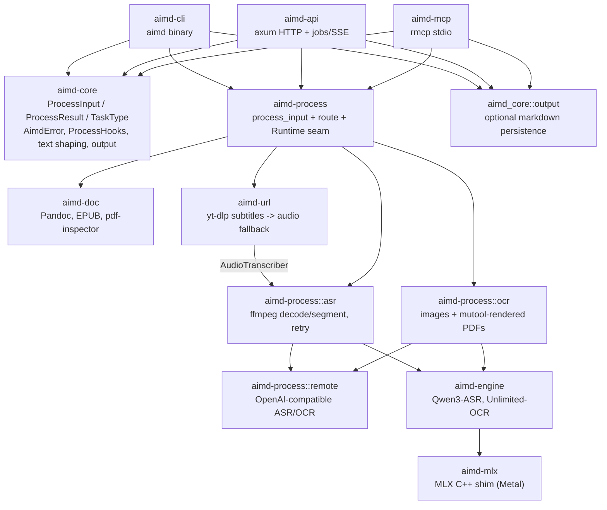

# PROJECT KNOWLEDGE BASE

**Generated:** 2026-10-26
**Version:** 1.1.0
**Branch:** main

## OVERVIEW

`aimd` is a native Rust context-preparation toolkit for LLM workflows. It turns URLs,
audio/video, and documents into Markdown plus a chunked text context. Local ASR
(Qwen3-ASR) and OCR (Unlimited-OCR) run on MLX through a C-ABI shim; there is no Python
runtime.

Interfaces (one binary each):

- **CLI**: `aimd` (`crates/aimd-cli`)
- **HTTP API**: `aimd-api` (`crates/aimd-api`, axum)
- **MCP server**: `aimd-mcp` (`crates/aimd-mcp`, rmcp stdio)

Distribution:

- **Homebrew**: `brew install shuuul/tap/aimd` (formula in `shuuul/homebrew-tap`).
  Bottles for macOS arm64. Linux (x86_64/aarch64, NVIDIA) builds from source against
  the tap's `mlx-cuda`, which repackages MLX's official `mlx-cuda-13` wheel; the NVIDIA
  driver, CUDA 13, cuDNN 9 and NCCL 2 come from the system. No Linux bottles: hosted
  runners have no NVIDIA driver to load `libmlx.so`.
- **Runtime deps** (formula `depends_on`): `mlx` (macOS) / `shuuul/tap/mlx-cuda`
  (Linux), `ffmpeg`, `mupdf` (`mutool`), `pandoc`, `yt-dlp`. Model weights download from Hugging Face on first use into the HF
  cache.
- **Version source**: `[workspace.package] version` in the root `Cargo.toml`.

## CRATE MAP

The Cargo workspace root is the repo root (`Cargo.toml`, `Cargo.lock`). `target*/` is
gitignored.

```text
crates/
├── aimd-weights/   # safetensors mmap; MLX affine 4/8-bit unpack (test-only bit-exact oracle); tests/golden/quant
├── aimd-mlx/       # C-ABI shim over MLX C++ (build.rs + shim/); device selection; needs brew mlx
├── aimd-engine/    # tokenizer, mel front-end, model graphs + generation (models/qwen3_asr, models/unlimited_ocr)
├── aimd-core/      # models, AimdError/ErrorKind, ProcessHooks, text shaping, precision, remote config,
│                   # extension tables, output persistence + shared help texts, logging; no heavy deps
├── aimd-doc/       # Pandoc conversion, EPUB (hand-written zip + OPF/spine), cleanup, pdf-inspector PDFs
├── aimd-url/       # yt-dlp metadata/subtitles/audio, cookies, metadata ASR context, dom_smoothie readable HTML
├── aimd-process/   # routing + orchestration: Runtime seam, local ASR/OCR, remote backends, model resolution, HF cache
├── aimd-cli/       # `aimd` binary: hand-written arg parser, output naming, .env loading
├── aimd-api/       # `aimd-api` binary: axum routes, jobs + SSE, blobs, sidecar auth/allow-roots
├── aimd-mcp/       # `aimd-mcp` binary: rmcp stdio server (healthz, process_input)
└── xtask/          # repo tooling (`cargo xtask check-specs`)
```

Dependency direction: `aimd-core` <- `aimd-doc`, `aimd-url` <- `aimd-process` (also
`aimd-engine`, `aimd-mlx`) <- `aimd-cli` / `aimd-api` / `aimd-mcp`. `aimd-doc` and
`aimd-url` depend only on `aimd-core`. The URL audio fallback reaches ASR through the
`aimd_url::AudioTranscriber` trait, which `aimd-process` implements
(`UrlAudioTranscriber`). This keeps the crate graph acyclic.

Other trees: `scripts/` holds the standalone PEP 723 reference exporters (used only to
regenerate goldens, not shipped). `docs/` holds architecture, sidecar, and performance
notes. `specs/` holds tracked execution specs.

## ARCHITECTURE DIAGRAM



## WHERE TO LOOK

| Task | Location | Notes |
|------|----------|-------|
| Input routing | `crates/aimd-process/src/route.rs` | `get_input_route` / `ensure_supported_input` map source kind + task into an `InputRoute`; `parse_task`. |
| Orchestration | `crates/aimd-process/src/lib.rs` | `process_input` / `process_input_with(request, hooks, &dyn Runtime)`; local-file dispatch, MarkItDown-style normalization, `TextContext` wrapping. |
| System seam | `crates/aimd-process/src/lib.rs`, `native.rs` | `Runtime` trait (env, `which`, subprocess, preflight, model loading, PDF probe); `NativeRuntime` is the real system. Tests override pieces. |
| PDF/OCR routing | `crates/aimd-process/src/native.rs` | pdf-inspector probe: scanned or `has_encoding_issues` PDFs route to OCR. |
| Model + precision resolution | `crates/aimd-process/src/models.rs` | Alias/precision to `mlx-community/*` ids; native gates (bf16 rejected); 8-bit fallback; ASR language codes. |
| Precision parsing | `crates/aimd-core/src/precision.rs` | Normalizes `4bit`/`6bit`/`8bit`/`bf16` and dash/space/case variants. |
| HF checkpoints | `crates/aimd-process/src/hf.rs` | Cache lookup (`HF_HUB_CACHE` > `HF_HOME/hub` > `~/.cache/huggingface/hub`), HTTPS snapshot download, `HF_TOKEN`, `HF_ENDPOINT`, `HF_HUB_OFFLINE`. |
| Local ASR | `crates/aimd-process/src/asr.rs`, `audio.rs` | ffmpeg decode to 16 kHz mono, >600 s segmenting, context, 4-bit -> 8-bit repetition retry. |
| Local OCR | `crates/aimd-process/src/ocr.rs` | Images and `mutool draw` PDF pages; per-page progress and cancellation. |
| Remote backends | `crates/aimd-core/src/remote.rs`, `crates/aimd-process/src/remote.rs` | `AIMD_{ASR,OCR}_{BASE_URL,MODEL,API_KEY}`, `/v1` suffix; ureq + rustls. |
| Request/result models | `crates/aimd-core/src/model.rs` | `ProcessInput`, `ProcessResult`, `TextContext`, `TaskType`, `SourceKind`; serde names are the wire format. |
| Errors | `crates/aimd-core/src/error.rs` | `AimdError { kind, message }`, `ErrorKind` with HTTP status + snake_case name. |
| Cancellation/progress | `crates/aimd-core/src/hooks.rs` | `ProcessHooks` (`is_cancelled`, `progress`, `check_cancelled`), `NoHooks`. |
| Text shaping | `crates/aimd-core/src/text.rs` | Title extraction and header/paragraph chunking (`MAX_CHUNK_SIZE`). |
| Output persistence + help texts | `crates/aimd-core/src/output.rs` | `persist_result_output_if_requested`; `MODEL_HELP_TEXT`, `PRECISION_HELP_TEXT`, `CONTEXT_HELP_TEXT`. |
| Extension tables | `crates/aimd-core/src/ext.rs` | Audio/video/image/OCR/asset extensions and the Pandoc reader map. |
| CLI | `crates/aimd-cli/src/args.rs`, `app.rs` | Hand-written parser over the frozen flag surface; output naming; `.env` loading. |
| HTTP API | `crates/aimd-api/src/` | `app.rs` routes, `jobs.rs` + `sse.rs`, `blobs.rs`, `paths.rs` (allow-roots), `validate.rs` (pydantic-compatible 422s), `openapi.json` (frozen schema). |
| MCP server | `crates/aimd-mcp/src/lib.rs` | Tool schemas, argument validation, `spawn_blocking` processing. |
| Document conversion | `crates/aimd-doc/src/` | `pandoc.rs`, `epub.rs` + `zip.rs` (hand-written), `clean.rs`, `pdf.rs` (pdf-inspector). |
| URL conversion | `crates/aimd-url/src/` | `ytdlp.rs`, `subtitles.rs`, `cookies.rs`, `metadata.rs` (`build_metadata_context`, 2000 chars), `audio.rs`, `readable.rs`. |
| Model graphs | `crates/aimd-engine/src/models/{qwen3_asr,unlimited_ocr}/` | MLX graphs, generation loops, n-gram guard, `test_support.rs` shared fixtures. |
| MLX shim | `crates/aimd-mlx/{build.rs,shim/,src/lib.rs}` | Links brew mlx (`MLX_PREFIX` override); `AIMD_MLX_DEVICE`. |
| Golden corpus | `scripts/corpus/`, `scripts/{build_corpus,corpus_baseline}.py`, `crates/aimd-engine/examples/corpus_gate.rs` | Labeled ASR/OCR accuracy gate vs the mlx-audio / mlx-vlm reference. |
| Tracked specs | `specs/` | Lifecycle, numbering, and index in `specs/README.md`. |

## CONVENTIONS

- **Core is interface-independent**: `aimd-core`, `aimd-doc`, `aimd-url`, `aimd-process`,
  and `aimd-engine` never depend on `aimd-cli`, `aimd-api`, or `aimd-mcp`. Interfaces build
  a `ProcessInput` and call `aimd_process::process_input`. Request/response shaping
  stays in the interface crate.
- **Route model**: classify inputs with `InputRoute { source_kind, task_type }`.
  `source_kind` is the supplied input kind, and `task_type` (`transcript`, `convert`,
  `ocr`) selects processing logic.
- **Runtime seam**: everything that touches the system (env, `PATH`, subprocesses, model
  loading, device preflight, PDF probing) goes through `aimd_process::Runtime`, so
  hermetic tests can substitute fakes. Interfaces receive an `Arc<dyn Runtime>` or a
  `Processor`.
- **Typed errors**: return `aimd_core::AimdError` with the right `ErrorKind`.
  Missing tools, models, or device (`pandoc`, `yt-dlp`, `ffmpeg`, `mutool`, MLX GPU) ->
  `BackendUnavailable`. Missing inputs -> `InputNotFound`. Unsupported inputs or options
  -> `UnsupportedInput`. Conversion failures -> `ProcessingFailed`. Cancellation ->
  `Cancelled`. `ErrorKind::status_code` is the HTTP mapping (400/422/404/500/409).
- **Cooperative job cancellation**: thread `&dyn ProcessHooks` through core, doc, URL,
  ASR, and OCR. Call `check_cancelled` only at safe boundaries (between segments, pages,
  chapters), never inside uninterruptible model calls or subprocesses. The API keeps
  completed artifacts from uninterruptible work as `completed_after_request`.
- **Output ownership**: `output_file` belongs to the CLI/API/MCP, not to `ProcessInput`
  or `ProcessResult`. Persist through `aimd_core::output`. Asset conversions
  (`output_dir` set) ignore `output_file`. Persisted files are `markdown`
  byte-for-byte, never rebuilt from `chunk_list`.
- **Stable output contract**: `ProcessResult` keeps the lossless `markdown`, an optional
  `asset_base_uri` (directory URIs end in `/`), an optional `output_dir`, and an optional
  `platform`, alongside `TextContext { title, chunk_list, split_header_level }`. Viewers
  consume `markdown`; context-window consumers use `chunk_list`.
- **Wire compatibility**: API/MCP JSON field names, error bodies, OpenAPI schema, and tool
  schemas match the frozen Python contract. Change them only with an explicit decision.
- **Desktop sidecar boundary**: `aimd-api` launches are authenticated
  (`AIMD_API_TOKEN`), loopback-only (`AIMD_HTTP_HOST`/`AIMD_HTTP_PORT`), and constrained
  by canonical `AIMD_ALLOWED_ROOTS`. See `docs/sidecar.md`.
- **Fail-fast preflight**: resolve the model and check the backend (MLX GPU device,
  required tools) before expensive work such as PDF rendering, downloads, or
  transcoding. Local inference on the MLX CPU device is `BackendUnavailable`.
- **URL cookie behavior**: keep automatic browser-cookie probing when no cookie option is
  supplied; it is intentional user convenience for restricted media. Explicit cookie
  options that yt-dlp rejects fail fast (`UnsupportedInput`). Subtitle and audio
  fallback failures must not be hidden behind metadata-only success results.
- **URL fallback ordering**: subtitles first (language preference order, then formats),
  then audio download + ASR. If both produce no text, the request is a processing
  failure. Stale-extractor yt-dlp stderr gets the `brew upgrade yt-dlp` hint.
- **Model naming**: user-facing aliases are kebab-case: `qwen3-asr-1.7b` (default),
  `qwen3-asr-0.6b`, and `unlimited-ocr`. Legacy underscore aliases and explicit
  `mlx-community/*` ids remain compatibility inputs but must not be the canonical names in
  docs or help text. GLM-OCR and Transformers/`Qwen/*` ids are not supported and must
  not reappear in help text.
- **Precision separation**: model family/size goes through `model`; quantization goes
  through the separate `precision` option. The parser accepts `4bit`, `6bit`, `8bit`, and
  `bf16` (dash/space/case variants normalized in `aimd_core::precision`). The native
  engine runs `4bit` (default), `6bit`, and `8bit`; `bf16` is rejected as
  `BackendUnavailable` until dense checkpoints are supported. A precision that conflicts
  with an explicit checkpoint id is an error.
- **Precision propagation**: `ProcessInput.precision` must be forwarded by CLI, HTTP API,
  MCP, URL audio fallback, local ASR, and OCR.
- **ASR context biasing**: `ProcessInput.context` (explicit text) and
  `ProcessInput.metadata_context` (default `true`) are forwarded by CLI
  (`--context`/`--no-context`), HTTP API, and MCP. `aimd-url` builds context from page
  metadata (title/author/description/tags/chapters, capped at 2000 chars) and merges it
  into the audio fallback. Qwen3-ASR consumes it as the system message. Never feed
  first-pass ASR output back as context.
- **4-bit retry**: a 4-bit Qwen3-ASR segment that trips the repetition-loop detector is
  retried once with the matching 8-bit checkpoint. Other precisions and remote ASR do not
  auto-switch.
- **Remote inference**: `AIMD_ASR_BASE_URL` / `AIMD_OCR_BASE_URL` (or the explicit
  CLI/API/MCP fields) opt into OpenAI-compatible HTTP backends and bypass local MLX
  preflight. Optional `AIMD_{ASR,OCR}_{MODEL,API_KEY}` have matching fields. Bare server
  URLs gain `/v1`. Explicit values override the environment. Remote precision is
  server-owned, so a local `precision` is ignored with one warning.
- **MLX only**: MLX is the only compute backend (Metal on macOS, the mlx CUDA backend on
  Linux). Do not add CPU compute paths or hand-written CUDA. The WS-08 custom Metal
  kernels are gated on `aimd_mlx::metal_kernels_available()`; other GPU backends use
  the stock mlx ops.
- **Linux build**: `aimd-mlx` links `libmlx.so` from `MLX_PREFIX` (brew `mlx-cuda`, or
  an unpacked `mlx-cuda-13` wheel for dev). Cargo applies the shim's rpath only to
  `aimd-mlx`'s own targets, so dev runs of dependents need
  `LD_LIBRARY_PATH=$MLX_PREFIX/lib` (brew's linker shim adds the rpath for installs).
  The shim points `CUDA_HOME` at `/opt/cuda` when unset and `/usr/local/cuda` is
  absent, because mlx's CUDA JIT needs the toolkit headers.
- **Document tools**: Pandoc (brew) reads every supported document format; `.txt`/`.md`
  pass through; legacy `.doc`/`.ppt`/`.xls` and MOBI/AZW3 are unsupported. Text-layer
  PDFs use the `pdf-inspector` crate; scanned pages render with `mutool draw`.
  Pandoc 3.12 rejects xlsx workbooks whose rels use absolute targets (openpyxl
  output); Excel-style relative targets convert.
- **Readable HTML**: `aimd_url::convert_readable_html` (dom_smoothie, with
  `AIMD_READABLE_BACKEND=defuddle` as an escape hatch) exists but is not routed from any
  interface. Do not advertise it until a `TaskType` routes to it.

## DEPENDENCY POLICY

Hand-write the simple parts; use third-party crates only for genuinely complex domains.

- **Hand-written**: CLI argument parsing, zip central-directory reading, OPF/spine
  walking, SSE framing, Netscape cookie parsing, sidecar path checks, UUIDs/timestamps,
  pydantic-style validation, `.env` parsing, TTML/srv subtitle XML parsing.
- **Third-party (approved)**: `axum` + `tokio` (async HTTP/SSE), `rmcp` (MCP),
  `serde`/`serde_json`, `pdf-inspector` (PDF text layer + OCR probe), `dom_smoothie`
  (readability), `regex`, `miniz_oxide` (deflate), `ureq` with `rustls` (remote backends,
  HF downloads), `image`, `tokenizers`, `safetensors`, `memmap2`, `half`, `thiserror`,
  `cc` (shim build).
- New crates need a stated reason that the domain is complex. Add shared versions under
  `[workspace.dependencies]` only with coordinator sign-off, because parallel builds
  share `Cargo.lock`.
- External tools come from Homebrew `depends_on`, never from a bundled downloader.

## TRACKED SPECS

Long-running, multi-workstream, or handoff-heavy work is tracked as execution
specs in `specs/` with a validated lifecycle. A spec records intent,
decisions, workstream progress, and acceptance evidence; it does not replace
durable docs, code, tests, or schemas. Stable behavior must still land in the
nearest `AGENTS.md`, docs, and code after closeout.

When a spec is required:

- Work spans multiple workstreams, agents, or explicit handoffs.
- Work needs coordinated decisions or acceptance evidence before parallel
  work starts.

How to write and close a spec:

1. Copy `specs/000-template.md` to `specs/NNN-kebab-case.md`. Reserve the
   next free ID by scanning both `specs/` and `specs/archive/`; never reuse,
   renumber, or delete an ID.
2. Fill the flat frontmatter (`id`, `title`, `status`, `created`, `updated`,
   `coordinator`) and every required section: `Context`, `Goal and success
   criteria`, `Scope and non-goals`, `Decisions`, `Workstreams`,
   `Verification`, `Documentation sync`, `Progress and handoff`, and
   `Completion summary`.
3. Add the index row to `specs/README.md` in ascending ID order and set
   `status: Active` once the contract is decision-complete. Reserve the ID
   and index the spec BEFORE parallel work starts.
4. Workers claim a workstream row (`WS-01`, ...) before editing and append
   entries under `Progress and handoff`; never rewrite another worker's
   history. Record blocking at the workstream level, not as a fourth status.
5. Close out by satisfying every success criterion (or recording the decision
   that removed one), syncing lasting knowledge into docs/`AGENTS.md`,
   completing the summary, setting `status: Completed`, and moving the file
   plus its index row to `specs/archive/` in the same change.
6. Run `cargo xtask check-specs` after any spec change and always before
   archiving.

Canonical lifecycle, numbering, coordination, and closeout rules live in
`specs/README.md`; the `xtask` validator enforces them structurally.

## MODEL AND PRECISION DESIGN

The user-facing model selection contract separates model family/size from
precision:

```bash
aimd audio.wav --model qwen3-asr-1.7b --precision 4bit
aimd audio.wav --model qwen3-asr-0.6b --precision 8bit
aimd scan.pdf --model unlimited-ocr --precision 8bit
```

Supported model families are intentionally narrow:

- **ASR**: `qwen3-asr-1.7b` (default) and `qwen3-asr-0.6b`. Omitted precision defaults
  to `4bit` and resolves to `mlx-community/Qwen3-ASR-{1.7B,0.6B}-{4bit,6bit,8bit}`.
  Local ASR defaults the language hint to Chinese. Supported codes: `zh en ja ko de es
  fr it pt ru`.
- **OCR**: `unlimited-ocr`, resolving to `mlx-community/Unlimited-OCR-{4bit,6bit,8bit}`
  (default 4bit). OCR uses single-image gundam mode (`document parsing.`), the
  sliding-window no-repeat n-gram guard (35/128), `max_tokens=8192`, and page-by-page PDF
  OCR.
- **bf16** resolves but is rejected by the native gate (`ensure_native_asr` /
  `ensure_native_ocr`).
- Explicit `mlx-community/*` ids for these families remain compatibility inputs; unknown
  models fail with the "Unsupported MLX ... model" `ProcessingFailed` message.

Checkpoints load once per model per process (API/MCP reuse loaded pipelines).

## TEST RULES

Tests are lean by rule; weights are the expensive resource.

- **One load per checkpoint per test binary**: checkpoint-backed tests get
  models/stores from a shared lazy fixture (`OnceLock<Option<_>>` in a
  `test_support` module; `None` = cache absent -> skip). Never call
  `Pipeline::load` / `load_checkpoint` on a real checkpoint inside an
  individual test.
- **Three tiers**:
  1. Hermetic (default `cargo test --workspace`): unit tests, committed golden slices,
     fake `Runtime`s, and fake tool scripts. No checkpoint, no network. Run it before
     every commit.
  2. Checkpoint parity: runs only when the HF cache is present and the MLX
     device is the GPU (`aimd_mlx::device_is_cpu()` false), always via the
     shared fixture.
  3. E2E / bench: behind `AIMD_E2E=1`; at most one E2E test per model per
     fixture image/clip. Anything that shells out to real tools (`say`, `ffmpeg`,
     `pandoc`, `yt-dlp`, `mutool`, `uv run` references) or writes outside a temp dir is
     tier 3.
  4. Golden-corpus gate (accuracy): `scripts/build_corpus.py` builds labeled
     `say` clips and rendered pages from `scripts/corpus/`,
     `scripts/corpus_baseline.py` records mlx-audio / mlx-vlm outputs, and the
     `corpus_gate` example scores both (ASR WER/CER <= baseline + 1%, OCR
     similarity >= baseline - 2%, stop rate no lower). Run it after any change
     that can move model outputs or when adding a model/precision.
- **Extend, don't duplicate**: a new stage check extends the existing golden
  test for that model; do not add a second test that covers the same stage
  or reloads the same weights. Delete tests made redundant by a backend or
  API change in the same change.
- **Golden fixtures**: live in the owning crate's `tests/golden/<set>/`, located via
  `env!("CARGO_MANIFEST_DIR")`. `quant` is owned by `aimd-weights` (`aimd-mlx` reads it
  via `../aimd-weights/tests/golden/quant`). `mel`, `tokenizer`, `asr_encoder`,
  `asr_decoder`, `ocr_vision`, `ocr_decoder`, and `ocr_e2e` belong to `aimd-engine`.
  `aimd-url/tests/golden/subtitles` is frozen: its Python oracle was deleted, so update it
  only with a reviewed, intentional behavior change. Regenerate the others with
  `uv run scripts/export_*_reference.py` (PEP 723 standalone scripts). Never hand-edit
  them.
- **Small fixtures**: committed golden files stay <= 1 MB each; larger dumps
  are regenerated by the exporters, not committed.
- **MLX device**: `AIMD_MLX_DEVICE=cpu|gpu` overrides the device (chosen once
  per process in the shim; CPU when no GPU is available). The hermetic tier runs with
  `AIMD_MLX_DEVICE=cpu` so it does not depend on a usable GPU. Tolerances
  are the same on both devices. MLX's CPU `quantized_matmul` is imprecise with
  bf16 inputs (error grows with K), so CPU-device tests feed it f32 activations,
  scales and biases rather than loosening bounds.
- **Backend-specific bounds**: the Unlimited-OCR vision stage/final-feature goldens
  pin Metal mlx rounding (the tower amplifies any rounding change past them), so they
  are enforced only when `metal_kernels_available()`; on CUDA they print the drift and
  the corpus gate is the accuracy check. Run the checkpoint tier and the corpus gate on
  a Linux GPU box (metacube, dspark) after changes that can move CUDA outputs.
- **Never download in tests**: no hf-hub fetches, no network in tiers 1-2.
- **No idle waits**: mock servers and job tests use short poll intervals; no
  `sleep`-based synchronization.
- **Budget**: hermetic `cargo test --workspace` should finish in about 2 minutes. A
  change that pushes it past that needs a stated reason.
- **Concurrent builds**: use `CARGO_TARGET_DIR=target-<name>` per agent/worker to avoid
  build-lock contention.

## ANTI-PATTERNS

- Embedding routing/orchestration in `aimd-cli`, `aimd-api`, or `aimd-mcp` instead of
  `aimd-process`.
- Depending on an interface crate from `aimd-core`, `aimd-doc`, `aimd-url`,
  `aimd-process`, or `aimd-engine`; adding a direct `aimd-url` -> `aimd-process` edge
  instead of using `AudioTranscriber`.
- Calling `std::env`, `PATH` lookups, or subprocesses directly in `aimd-process` code
  paths instead of going through `Runtime`.
- Returning ad-hoc string errors or panicking where an `AimdError` kind exists.
- Checking cancellation inside uninterruptible model calls, or discarding a completed
  artifact because cancellation arrived late.
- Changing URL subtitle/cookie/audio fallback ordering without explicit tests.
- Removing automatic URL browser-cookie probing without an explicit product decision;
  simplify surrounding error handling instead.
- Returning metadata-only URL output as a successful transcript when subtitle extraction
  and audio transcription both failed.
- Reintroducing removed options (GLM-OCR, Transformers/CUDA Python backends, bf16 help
  text claiming support) or listing them in help text.
- Adding a third-party crate for a simple domain, or a tool downloader instead of a brew
  `depends_on`.
- Adding CPU compute paths alongside MLX, or broad abstractions before a second backend
  needs them.
- Hand-editing golden fixtures.

## COMMANDS

```bash
# Prerequisites
brew install mlx ffmpeg mupdf pandoc yt-dlp prek

# Code quality
cargo fmt --all --check
cargo clippy --workspace --all-targets -- -D warnings
prek run --all-files

# Tests
cargo test --workspace                       # Metal when available
AIMD_MLX_DEVICE=cpu cargo test --workspace   # hermetic tier (pre-commit gate)
AIMD_E2E=1 cargo test -p aimd-engine --lib   # tier 3, needs the HF cache
AIMD_E2E=1 cargo test -p aimd-process --test e2e
AIMD_E2E=1 cargo test -p aimd-url --test e2e

# Specs
cargo xtask check-specs

# Build and run
cargo build --release -p aimd-cli -p aimd-api -p aimd-mcp
./target/release/aimd audio.mp3 --model qwen3-asr-1.7b --precision 4bit
./target/release/aimd "https://youtube.com/..." --cookies-from-browser chrome --raw-transcript
./target/release/aimd audio.mp3 --temp-dir ./tmp --log-level DEBUG
./target/release/aimd-api
curl http://127.0.0.1:8000/healthz
./target/release/aimd-mcp

# Regenerate a golden set (not shipped; needs uv)
uv run scripts/export_mel_reference.py

# Golden-corpus accuracy gate (macOS: say + Chrome; corpus in target/corpus)
uv run scripts/build_corpus.py
uv run scripts/corpus_baseline.py
cargo run --release -p aimd-engine --example corpus_gate
```

## BEFORE EVERY COMMIT

Run the hooks and the Rust gates, and include any hook-generated fixes in the commit:

```bash
prek run --all-files
cargo fmt --all --check
cargo clippy --workspace --all-targets -- -D warnings
AIMD_MLX_DEVICE=cpu cargo test --workspace
```

If `prek` modifies files, review the diff, stage the updates, and run
`prek run --all-files` again before committing. The hooks (`.pre-commit-config.yaml`)
run whitespace/YAML checks, `cargo fmt`, and `ruff` for the Python exporters in
`scripts/`.

Use Conventional Commits:

```text
feat(asr): add context biasing to remote ASR
fix(url): preserve subtitle fallback errors
perf(engine): ring KV cache for the Qwen3 decoder
docs(performance): record M2 Pro OCR results
chore(deps): bump axum
```

Breaking changes: add `!` after the type/scope (for example `feat(api)!: change process
response`) and include a `BREAKING CHANGE:` footer.

## RELEASE PROCESS

Releases are manual and tag-driven; release-please is not used.

1. Bump `[workspace.package] version` in the root `Cargo.toml`.
2. Run `cargo update --workspace` to refresh the workspace versions in `Cargo.lock`.
3. Commit `chore(release): vX.Y.Z` on `main`.
4. Push the tag `vX.Y.Z`.
5. `.github/workflows/release.yml` (on `v*` tags) verifies that the tag matches the
   workspace version (`cargo metadata --locked`), builds and smoke-tests the three
   binaries on macOS arm64, creates the GitHub Release with generated notes, and opens the
   formula bump PR (url + sha256) on `shuuul/homebrew-tap` using the `HOMEBREW_TAP_TOKEN`
   secret.
6. In the tap, brew test-bot builds bottles on that PR, and the tap's `publish.yml`
   (`brew pr-pull`) publishes them.

Release notes come from the GitHub Release (there is no `CHANGELOG.md`).

## CI

CI only packages; tests run locally. Before a release, run the commit gates plus the
checkpoint tier and the corpus gate on a Metal Mac (and on metacube for Linux CUDA).

- `.github/workflows/release.yml`: release build, smoke test, GitHub Release, and tap PR
  (see above). There is no PR/push test workflow.
