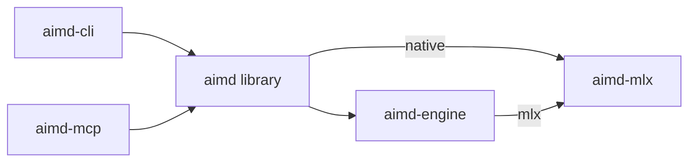

# Architecture

## Overview

The workspace ships `aimd` and `aimd-mcp` through Homebrew. Both interfaces build
a `ProcessInput` and call the `aimd` library. The CLI owns argument parsing and
the MCP crate owns the rmcp stdio server, request validation, and response shaping.

- `aimd` holds request and result types, Markdown shaping, routing, format adapters,
  local and remote orchestration, checkpoint resolution, and output helpers.
- `aimd-engine` owns the safetensors store, tokenizer, audio and image preprocessing,
  and model graphs and generation for Qwen3-ASR, Qwen3-ForcedAligner,
  Unlimited-OCR 1/2, and PP-OCRv6.
- `aimd-mlx` wraps the MLX C++ API. It runs on Metal on macOS and the MLX CUDA
  backend on Linux. The bit-exact quantization oracle lives in its tests.
- `xtask` validates specs and module imports.

## Dependency Rules

`cargo xtask check-modules` checks `use crate::` imports in `aimd`. The interface
crates call the public `aimd` API. The `model`, `error`, `hooks`, `output`, `log`,
`text`, and `anchors` modules share the request and result contract. They import
other contract modules, and `text` shares Python-compatible string helpers with
`util::pytext`. `sys` and `util` depend on the contract. `doc` and `url` use the
contract, `sys`, `util`, and `ext`, with independent adapter implementations. The
orchestration modules can use any of these modules.

`sys::System` provides environment lookup, executable lookup, and subprocess
capture. The document and URL adapters accept this interface for Pandoc, yt-dlp,
Firecrawl Local, and Defuddle. `Runtime` extends `System` with MLX preflight,
model loading, and PDF probing. `NativeRuntime` provides the real system for the
CLI and MCP. The `url` module's internal `AudioTranscriber` lets the orchestrator
supply ASR for the audio fallback. Adapter tests substitute `System` to verify
tool arguments and control responses.

CLI and MCP own output destinations and persist requested files through
`aimd::output`. `ProcessInput` carries source processing options.

## Primary Flow

1. CLI/MCP receives the request and builds a `ProcessInput`.
2. The interface calls `aimd::process_input(&input, &hooks)` (MCP runs
   it on a blocking worker).
3. `ensure_supported_input` classifies the source into an `InputRoute { source_kind,
   task_type }`. For PDFs, the pdf-inspector probe sends scanned PDFs and PDFs with
   broken font encodings to OCR.
4. Dispatch:
   - URL transcript requests use `aimd::url` for subtitles, then audio download and ASR.
   - `readable` uses Firecrawl Local for URLs and `dom_smoothie` for files. Setting
     `AIMD_READABLE_BACKEND=defuddle` selects Defuddle for both.
   - `transcript` -> local or remote ASR.
   - `ocr` -> local or remote OCR (images, or PDF pages rendered by `mutool`).
   - `convert` uses `aimd::doc` for Pandoc, EPUB, PDF, and text passthrough.
5. Local results are normalized (trailing whitespace stripped per line, runs of three or
   more newlines collapsed). `process_input` then returns the lossless Markdown, its
   asset base, and the shaped `TextContext`.
6. The interface maps `ProcessResult` to its response or output and persists
   `output_file` if requested.

`ProcessResult.markdown` is the exact converter output before context splitting.
`TextContext.chunk_list` is the context-window representation and is not a lossless
viewer artifact. `asset_base_uri` takes one of these values:

- the original URL, for URL processing;
- the generated asset directory, for document conversions that emit one;
- the input's parent directory, for other local convert/OCR work;
- `None`, for local transcriptions.

Local directory URIs always end in `/` so standards-based URL joining keeps directory
semantics.

Asset-producing document conversions (`.docx`, `.epub`, `.odt`) create `output_dir`
beside the local source. The directory is durable caller-owned output, not
request-scoped temporary storage. aimd does not clean it up when an interface call
completes. Interfaces therefore ignore a separately requested `output_file` for these
results, so relative links stay valid. Other requested files are written byte-for-byte
from `ProcessResult.markdown`; interfaces must not rebuild them from
`TextContext.chunk_list`.

## Backend And Model Boundaries

| Task | Boundary | Model source |
|------|----------|--------------|
| Transcript | `aimd::url` for URL subtitles/audio; `aimd::asr` for transcription | Qwen3-ASR 1.7B/0.6B (`mlx-community/Qwen3-ASR-*-{4,6,8}bit`) on MLX, or remote `/v1/audio/transcriptions` when `AIMD_ASR_BASE_URL` is set. |
| Convert | `aimd::doc` | Pandoc CLI, pdf-inspector, passthrough for `.txt`/`.md`. |
| OCR | `aimd::ocr` | Unlimited-OCR (`mlx-community/Unlimited-OCR-{4,6,8}bit`, 5-page PDF windows) or Unlimited-OCR-2 (`mlx-community/Unlimited-OCR-2-{4,6,8}bit`, 10-page PDF windows) on MLX, or remote `/v1/chat/completions` when `AIMD_OCR_BASE_URL` is set. |

The README is the user-facing source of truth for `--model` values. Resolution lives in
`crates/aimd/src/models.rs`, and the CLI help texts live in `crates/aimd/src/output.rs`.
Each checkpoint is loaded once per process and reused. Before loading, local inference
checks that the MLX GPU device is active; on the CPU device it fails with
`BackendUnavailable`.

Remote settings flow through `ProcessInput`, so CLI, MCP, local-file work, and the
URL audio fallback share one selection path. Explicit request values override
`AIMD_{ASR,OCR}_{BASE_URL,MODEL,API_KEY}`. A configured remote URL bypasses the local MLX
preflight. Without one, local inference is used.

The `aimd` library enables `native` by default, which enables the engine's `mlx`
feature and local model loading. With `default-features = false`, the library
builds and runs without MLX and reports `BackendUnavailable` for local ASR and
OCR. Document conversion, readable HTML, URL subtitles, and remote ASR and OCR
are available in this build. The shipped binaries use the default features.

HTTP connections (including proxy negotiation and TLS handshakes) have a 15-second
budget, capped by the caller's total timeout. Remote inference keeps its 600-second
total budget with no separate response-header deadline: non-streaming servers may
not send headers until generation finishes. This requires ureq 3.5 or later.

ASR segmentation owns a unique temporary subdirectory for each request, including
when `--temp-dir` is supplied. Only that directory is removed on completion or
failure; same-named inputs cannot overwrite another request's segments.

HF cache hits require configuration, tokenizer files (or the PP-OCRv6 recognition
character table), and weights. A safetensors index requires every referenced shard.
Partial snapshots are repaired by downloading missing files when online; offline
requests fail explicitly rather than returning an incomplete checkpoint.

For performance expectations and benchmarks, see [Performance](performance.md).

## Cancellation And Progress

Every pipeline receives `&dyn ProcessHooks`. Pipelines report progress stages
(`extracting`, `downloading`, `transcribing`, `converting`, `recognizing`) with unit
counts when known. They call `check_cancelled()` only at safe boundaries: between ASR
segments, OCR pages, and EPUB chapters. Model calls and subprocesses are never
interrupted; a cancellation that arrives during uninterruptible work keeps the
completed artifact instead of discarding it.

## Error Handling

Errors are `aimd::AimdError { kind, message }` end-to-end. Each pipeline maps
failures at its boundary:

- Missing tools, models, or device (`pandoc`, `yt-dlp`, `ffmpeg`, `mutool`, MLX GPU,
  unsupported bf16 checkpoint) -> `BackendUnavailable`
- Missing input paths -> `InputNotFound`
- Unsupported inputs, options, or rejected cookie options -> `UnsupportedInput`
- Conversion/transcription failures, unknown models -> `ProcessingFailed`
- Cooperative cancellation -> `Cancelled`

The CLI logs the message to stderr and exits non-zero. MCP returns the message as a tool
error.
